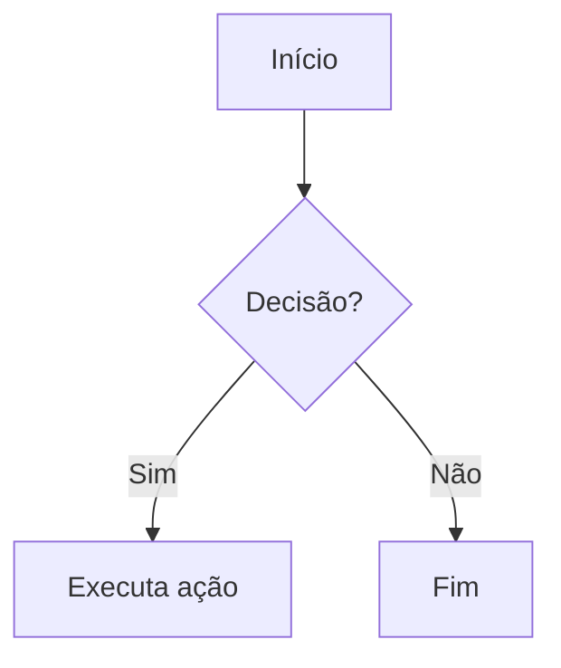
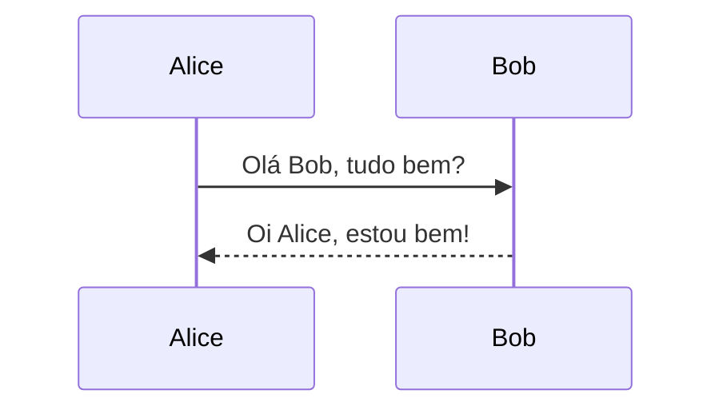
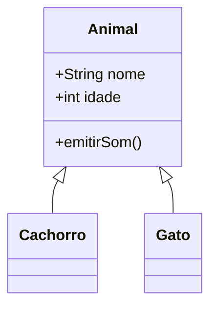
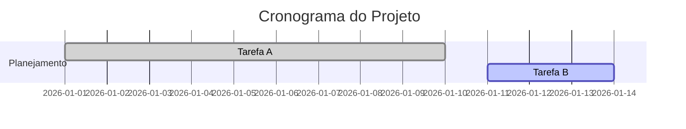

# Guia Prático da Linguagem Markdown


Bem-vindo(a) ao **Guia Prático da Linguagem Markdown**!

Este material foi preparado para iniciantes que desejam aprender a utilizar Markdown na criação de **documentação, arquivos README, anotações, páginas de projetos, documentação do Jupyter Notebook e outros conteúdos formatados em texto**.

Markdown é uma linguagem de marcação leve, criada para permitir que um texto simples seja estruturado e formatado utilizando caracteres comuns, sem depender de editores visuais complexos.

> **Importante:** Markdown possui uma sintaxe básica, mas diferentes ferramentas e plataformas podem oferecer extensões e recursos adicionais. Por isso, alguns exemplos deste guia dependem do ambiente utilizado para renderizar o Markdown.

<br />

##  1. Introdução


O **Markdown** é uma linguagem de marcação leve criada em 2004 por **John Gruber**, em colaboração com Aaron Swartz.

Seu objetivo original era permitir que as pessoas escrevessem utilizando um formato simples e fácil de ler, que pudesse posteriormente ser convertido para HTML.

Um arquivo Markdown normalmente utiliza a extensão `.md`

Por exemplo:

- README.md
- documentacao.md
- anotacoes.md

Um dos principais benefícios do Markdown é que o conteúdo continua sendo legível mesmo quando não está sendo renderizado.

Por exemplo:

```markdown
# Meu Projeto

Este é um projeto desenvolvido em Python.

## Tecnologias

- Python
- Git
- GitHub
```

Mesmo em um editor de texto simples, conseguimos compreender a estrutura do documento.

O Markdown é utilizado em diversos contextos, como:

- Documentação técnica;
- Arquivos README;
- Anotações;
- Documentação de projetos;
- Wikis;
- Blogs e sites estáticos;
- Repositórios de código;
- Sistemas de documentação.

<br />

##  2. Markdown, extensões e recursos de plataformas


Antes de começar, é importante entender uma diferença:

**Markdown não é exatamente igual em todos os ambientes.**

Existe uma sintaxe básica de Markdown, enquanto ferramentas e plataformas podem implementar recursos adicionais.

Podemos pensar em três categorias:

| Categoria                        | Exemplos                                          |
| -------------------------------- | ------------------------------------------------- |
| Markdown                         | títulos, listas, links, imagens, citações, código |
| Extensões de Markdown            | tabelas, task lists, tachado                      |
| Recursos externos ou específicos | Mermaid, badges, recursos do GitHub               |

O **GitHub Flavored Markdown (GFM)**, por exemplo, adiciona funcionalidades ao Markdown utilizadas pelo GitHub. Entre elas estão tabelas, listas de tarefas e outros recursos específicos da plataforma.

<br />

> [!TIP]
>
> Ao criar um documento Markdown, verifique quais recursos são suportados pela ferramenta onde o arquivo será utilizado.

<br />

## 🚀 3. Por que usar Markdown?


- **Simples:** Markdown utiliza caracteres comuns para criar a formatação, ou seja, não é necessário utilizar um editor visual para escrever um documento.
- **Legível:** Mesmo sem renderização, o código-fonte continua relativamente fácil de compreender.
- **Portátil:** Arquivos `.md` são arquivos de texto e podem ser abertos em diversos editores.
- **Amplo suporte:** Markdown é utilizado por diversas ferramentas de desenvolvimento, documentação e publicação.
- **Fácil de versionar:** Como o arquivo é texto, ferramentas como Git conseguem identificar facilmente alterações realizadas no conteúdo.
- **Extensível:** Diferentes ferramentas podem adicionar recursos como tabelas, fórmulas, diagramas e outros elementos.

<br />

## 4. Títulos


Utilizamos o caractere `#` para criar títulos. A quantidade de `#` determina o nível do título.

```markdown
# Título nível 1

## Título nível 2

### Título nível 3

#### Título nível 4

##### Título nível 5

###### Título nível 6
```

O título principal normalmente utiliza:

```markdown
# Título principal
```

Subseções podem utilizar:

```markdown
## Seção

### Subseção
```

Procure manter uma hierarquia lógica:

```markdown
# Projeto

## Introdução

## Instalação

### Windows

### Linux

## Utilização

## Contribuição
```

Evite escolher títulos apenas pelo tamanho visual. O nível do título representa a **hierarquia do conteúdo**.

<br />

## 5. Formatação de texto


Markdown permite aplicar diferentes formas de destaque ao texto.

### 5.1 Itálico

```markdown
*Texto em itálico*
```

ou:

```markdown
_Texto em itálico_
```

**Resultado:**

*Texto em itálico*

<br />

### 5.2 Negrito

```markdown
**Texto em negrito**
```

ou:

```markdown
__Texto em negrito__
```

**Resultado:**

**Texto em negrito**

<br />

### 5.3 Negrito e itálico

```markdown
***Texto em negrito e itálico***
```

**Resultado:**

***Texto em negrito e itálico***

<br />

### 5.4 Texto tachado

```markdown
~~Texto removido~~
```

**Resultado:**

~~Texto removido~~

<br />

> [!IMPORTANT]
>
> O tachado é um recurso amplamente utilizado, mas está associado às extensões de Markdown implementadas por determinados ambientes, como o GitHub Flavored Markdown.

<br />

## 6. Parágrafos e quebras de linha


Uma linha vazia normalmente cria um novo parágrafo.

```markdown
Este é o primeiro parágrafo.

Este é o segundo parágrafo.
```

Para criar uma quebra de linha dentro do mesmo parágrafo, uma possibilidade é utilizar dois espaços no final da primeira linha:

```markdown
Primeira linha  
Segunda linha
```

Outra possibilidade, dependendo do ambiente, é utilizar uma barra invertida:

```markdown
Primeira linha\
Segunda linha
```

Também é possível utilizar HTML:

```html
Primeira linha<br>
Segunda linha
```

<br />

> [!WARNING]
>
> O comportamento de quebras de linha pode variar conforme o ambiente que renderiza o Markdown.

<br />

## 7. Listas


Listas são úteis para organizar informações.


### 7.1 Lista não ordenada

Podemos utilizar `-`, `*` ou `+`.

```markdown
- Item 1
- Item 2
- Item 3
```

Também:

```markdown
* Item 1
* Item 2
* Item 3
```

Ou:

```markdown
+ Item 1
+ Item 2
+ Item 3
```

O formato com `-` é bastante utilizado por ser simples e consistente.

<br />

### 7.2 Lista aninhada

Podemos criar subitens utilizando indentação:

```markdown
- Frontend
  - HTML
  - CSS
  - JavaScript
- Backend
  - Java
  - Python
  - C#
```

**Resultado:**

- Frontend
  - HTML
  - CSS
  - JavaScript
- Backend
  - Java
  - Python
  - C#

<br />

### 7.3 Lista ordenada

Utilizamos números seguidos de ponto:

```markdown
1. Primeiro
2. Segundo
3. Terceiro
```

**Resultado:**

1. Primeiro
2. Segundo
3. Terceiro

<br />

## 8. Citações


Utilizamos `>` para criar uma citação.

```markdown
> Esta é uma citação.
```

**Resultado:**

> Esta é uma citação.

Também podemos criar citações aninhadas:

```markdown
> Citação principal
>
> > Citação dentro da citação
```

**Resultado:**

> Citação principal
>
> > Citação dentro da citação

As citações podem ser utilizadas para destacar:

- Definições;
- Observações;
- Trechos de outros textos;
- Informações importantes.

<br />

## 9. Tabelas


Tabelas utilizam barras verticais `|` para separar as colunas.

Um exemplo:

```markdown
| Nome  | Idade | Cidade         | 
|-------|------:|----------------| 
| Ana   | 25    | São Paulo      | 
| João  | 30    | Rio de Janeiro |
```

**Resultado:**

| Nome | Idade | Cidade         |
| ---- | ----- | -------------- |
| Ana  | 25    | São Paulo      |
| João | 30    | Rio de Janeiro |

Podemos controlar o alinhamento utilizando `:`.

```markdown
| Esquerda | Centro | Direita | 
|:---------|:------:|--------:| 
| Texto    | Texto  | Texto   |
```

**Resultado:**

| Esquerda | Centro | Direita |
| -------- | :----: | ------: |
| Texto    | Texto  |   Texto |

- `:---` → esquerda
- `:---:` → centro
- `---:` → direita

As tabelas são uma extensão amplamente adotada do Markdown, incluindo o GitHub Flavored Markdown.

<br />

## 10. Links


Links utilizam a seguinte estrutura:

```markdown
[Texto do link](URL)
```

Exemplo:

```markdown
[Google](https://www.google.com)
```

**Resultado:**

[Google](https://www.google.com/)

<br />

### 10.1 Link com título

Também podemos adicionar um título:

```markdown
[GitHub](https://github.com "Acesse o GitHub")
```

<br />

### 10.2 Links de referência

Em documentos com muitos links, podemos utilizar referências.

```markdown
[GitHub][1]

[1]: https://github.com
```

Também podemos utilizar um identificador textual:

```markdown
[Documentação][docs]

[docs]: https://docs.github.com/
```

Essa abordagem ajuda a manter o texto mais organizado quando o mesmo endereço é utilizado várias vezes.

<br />

## 11. Imagens


A sintaxe de imagem é semelhante à sintaxe de links.

```markdown

```

Exemplo:

```markdown

```

A estrutura é:

```text

```

O texto alternativo é importante porque descreve a imagem quando ela não pode ser visualizada e contribui para a acessibilidade.

<br />

### 11.1 Imagem com título

Também podemos adicionar um título:

```markdown

```

<br />

### 11.2 Imagem local

Também podemos utilizar uma imagem armazenada no projeto:

```markdown

```

Nesse caso, o caminho deve estar correto em relação ao arquivo Markdown.

> **Boa prática:** quando o Markdown faz parte de um projeto, imagens locais podem ser uma alternativa mais controlável do que depender exclusivamente de URLs externas.

<br />

##  12. Código


Markdown permite apresentar pequenos trechos de código dentro de um texto ou blocos completos. 


### 12.1 Código inline

Para pequenos trechos, utilizamos crases:

```markdown
Utilize o comando `git status` para consultar o estado do repositório.
```

**Resultado:**

Utilize o comando `git status` para consultar o estado do repositório.

<br />

### 12.2 Bloco de código

Para criar um bloco de código, utilizamos três crases:

~~~markdown
```python
print("Olá, mundo!")
```
~~~

**Resultado:**

```python
print("Olá, mundo!")
```

<br />

### 12.3 Identificando a linguagem

Podemos informar a linguagem logo após as três crases:

~~~markdown
```javascript
console.log("Olá, mundo!");
```
~~~

ou:

~~~markdown
```java
System.out.println("Olá, mundo!");
```
~~~

ou:

~~~markdown
```python
print("Olá, mundo!")
```
~~~

O identificador da linguagem permite que ambientes compatíveis realizem **realce de sintaxe (syntax highlighting)**.

<br />

> [!WARNING]
>
> Os blocos de código em Markdown servem apenas para **exibir e formatar o código**, facilitando sua leitura e documentação. Eles **não executam o código**. A execução depende de uma ferramenta ou ambiente específico que seja capaz de interpretar aquela linguagem.

<br />

## 13. Listas de tarefas


Algumas implementações de Markdown oferecem suporte a listas de tarefas.

Um exemplo é o GitHub Flavored Markdown:

```markdown
- [ ] Estudar Markdown
- [ ] Criar um README
- [x] Criar um repositório
```

No GitHub, isso é renderizado como:

-  Estudar Markdown
-  Criar um README
-  Criar um repositório

A sintaxe utiliza:

```text
[ ] → tarefa pendente
[x] → tarefa concluída
```

<br />

> [!IMPORTANT]
>
> Listas de tarefas são uma extensão do Markdown, não devem ser tratadas como parte da sintaxe básica universal. O suporte depende do ambiente.

<br />

## 14. Badges


Badges são pequenos elementos visuais utilizados principalmente em projetos de software para apresentar informações como:

- Versão;
- Licença;
- Status da compilação;
- Cobertura de testes;
- Tecnologias utilizadas;
- Status do projeto.

Um exemplo:

```markdown


```

Resultado:


<br />

> [!WARNING]
>
> **Badge não é um recurso próprio do Markdown**, o Markdown apenas permite inserir a imagem fornecida por um serviço externo.
>
> O [Shields.io](https://shields.io/) é um dos serviços utilizados para criar badges para projetos.
>

<br />

## 15. Diagramas com Mermaid


**Mermaid** é uma linguagem utilizada para criar diagramas a partir de uma descrição textual.

A sintaxe do Mermaid permite criar diferentes tipos de diagramas, como:

- Fluxogramas;
- Diagramas de sequência;
- Diagramas de classes;
- Diagramas de entidade-relacionamento;
- Gráficos de Gantt;
- Entre outros.

<br />

> [!IMPORTANT]
>
> Mermaid não faz parte da sintaxe básica do Markdown. É um recurso adicional oferecido por determinadas ferramentas e plataformas.

<br />

A documentação oficial do Mermaid define sua própria sintaxe para a criação dos diagramas.

<br />

### 15.1 Fluxograma



<br />

### 15.2 Diagrama de sequência



<br />

### 15.3 Diagrama de classes



<br />

### 15.4 Gráfico de Gantt



> [!WARNING]
>
> Um bloco `mermaid` só será renderizado como diagrama quando a ferramenta utilizada oferecer suporte ao Mermaid.

<br />

## 16. Fórmulas matemáticas com LaTeX


Alguns ambientes Markdown oferecem suporte a expressões matemáticas utilizando **LaTeX** ou uma sintaxe baseada nele.

Assim como Mermaid, **LaTeX não é parte da sintaxe básica do Markdown**.

O ambiente responsável pela renderização precisa oferecer suporte a fórmulas matemáticas.

<br />

### 16.1 Fórmula inline

Para colocar uma fórmula dentro de uma frase:

```latex
$$
x^2 + y^2 = z^2
$$
```

**Resultado:**
$$
x^2 + y^2 = z^2
$$
<br />

### 16.2 Fórmula em bloco

Para destacar uma fórmula:

```latex
$$
x = \frac{-b \pm \sqrt{b^2 - 4ac}}{2a}
$$
```

**Resultado:**
$$
x = \frac{-b \pm \sqrt{b^2 - 4ac}}{2a}
$$
<br />

### 16.3 Outros exemplos

### 🔢 Potência

```latex
$$
x^2
$$
```

**Resultado**
$$
x^2
$$

### 🔢 Índice

```latex
$$
a_1
$$
```

**Resultado**
$$
a_1
$$

### 🔢 Fração

```latex
$$
\frac{a}{b}
$$
```

**Resultado**
$$
\frac{a}{b}
$$

### 🔢 Raiz quadrada

```latex
$$
\sqrt{x}
$$
```

**Resultado**
$$
\sqrt{x}
$$

### 🔢 Somatório

```latex
$$
\sum_{i=1}^{n} x_i
$$
```

**Resultado**
$$
\sum_{i=1}^{n} x_i
$$
A sintaxe exata e o suporte podem variar de acordo com o renderizador utilizado.

<br />

> [!TIP]
>
> Para construir fórmulas em **LaTeX** de forma mais prática, utilize o Editor de fórmulas LaTeX online, disponível no site **[CodeCogs](https://editor.codecogs.com/)**. Ela permite montar a expressão visualmente, semelhante ao Editor de Equações do Office 365 e obter o código LaTeX correspondente, facilitando sua utilização no Markdown.

<br />

## 17. HTML dentro do Markdown


Markdown permite a utilização de elementos HTML em ambientes que oferecem esse suporte.

Por exemplo:

```html
<p>Este é um parágrafo em HTML.</p>
```

Também podemos utilizar elementos como:

```html
<kbd>Ctrl</kbd> + <kbd>C</kbd>
```

**Resultado:**

Ctrl + C

Outro exemplo:

```html
Texto<sup>sobrescrito</sup>

Texto<sub>subscrito</sub>
```

**Resultado:**

Textosobrescrito

Textosubscrito

<br />

### 17.1 Elemento `<details>`

Alguns ambientes também permitem utilizar:

```html
<details>
    <summary>Mostrar conteúdo</summary>

    Conteúdo escondido.
</details>
```

**Resultado:**

```
Conteúdo escondido.
```

<br />

> [!IMPORTANT]
>
> O suporte e o comportamento de HTML podem variar conforme o renderizador Markdown utilizado.

<br />

> [!TIP]
>
> Utilize Markdown sempre que ele atender à necessidade. Recorra ao HTML quando precisar de um recurso que não esteja disponível na sintaxe Markdown utilizada pelo ambiente.

<br />

## Referências e recursos extras


### Markdown

- [CommonMark – Especificação do Markdown](https://spec.commonmark.org/)

### GitHub Flavored Markdown

- [GitHub Flavored Markdown – Especificação](https://github.github.com/gfm/)
- [GitHub – Sintaxe básica de escrita e formatação](https://docs.github.com/en/get-started/writing-on-github/getting-started-with-writing-and-formatting-on-github/basic-writing-and-formatting-syntax)
- [GitHub – Sobre Markdown e GitHub Flavored Markdown](https://docs.github.com/en/get-started/writing-on-github/getting-started-with-writing-and-formatting-on-github/about-writing-and-formatting-on-github)

### Mermaid

- [Mermaid – Documentação oficial](https://mermaid.js.org/)

### Badges

- [Shields.io](https://shields.io/)

<br />
